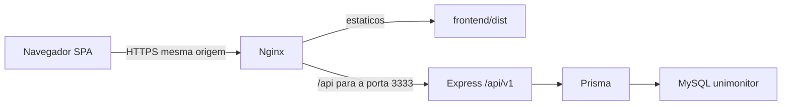
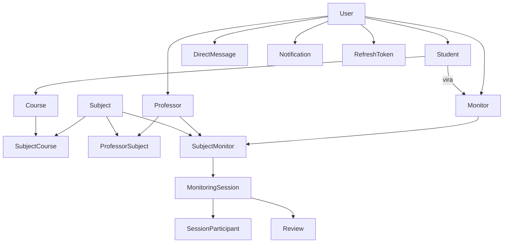

# UniMonitor

Aplicação web com backend em Node.js (Express + TypeScript + Prisma/MySQL) e frontend em React (Vite + TypeScript).

O UniMonitor e uma plataforma de monitoria academica: o admin organiza cursos, disciplinas e professores; o professor vincula monitores; o monitor publica sessoes; o aluno encontra vagas, participa e avalia.

## Como rodar

Pré-requisitos: Node.js 22.12+ — validado no **24.19.0 LTS** — e acesso ao MySQL.

```bash
# Backend — http://localhost:3333
cd backend
cp .env.example .env     # preencha DATABASE_URL e os segredos JWT
npm install
npm run prisma:generate
npm run prisma:deploy    # aplica as migrations
npm run db:seed          # cria o administrador inicial
npm run dev

# Frontend — http://localhost:5173
cd frontend
cp .env.example .env
npm install
npm run dev
```

O Vite encaminha `/api` para `http://localhost:3333`, então front e API compartilham a origem em desenvolvimento e os cookies de sessão são first-party.

Contas do seed (periodo letivo atual):

| Perfil | E-mail | Senha |
| --- | --- | --- |
| Admin | admin@unimonitor.local | a definida em `SEED_ADMIN_PASSWORD` |
| Professor | joao@unimonitor.local | Prof@123456 |
| Monitora | maria@unimonitor.local | Monitor@123456 |
| Aluno | vittor@unimonitor.local | Aluno@123456 |

## Arquitetura

SPA React + API REST Express, MySQL como unica fonte de verdade e autenticacao por cookies `httpOnly`. Front e API compartilham a mesma origem (`/api`) para a sessao ser first-party.

| Camada | Stack |
| --- | --- |
| Frontend | React 19, Vite 8, TypeScript, React Router 7, TanStack Query, Axios |
| Backend | Node 22+, Express 5, TypeScript ESM, Zod, Pino, Helmet |
| Banco | MySQL 8 via Prisma 7 + `@prisma/adapter-mariadb` |
| Auth | JWT de 15 min (cookie) + refresh opaco com HMAC no banco |
| Docs | Swagger em `/api/docs` (em producao so `ADMIN`) |

Nao ha Redis, Socket.IO, filas nem GraphQL. Notificacoes sao HTTP com polling a cada 30s. Mensagens sao REST, nao tempo real.



- **Desenvolvimento:** Vite em `:5173` faz proxy de `/api` para `localhost:3333`.
- **Producao:** Nginx serve o `dist` e encaminha `/api` para o Node em `127.0.0.1:3333` (PM2).
- O front chama sempre `VITE_API_BASE_URL=/api/v1` (relativo). Cookies `SameSite=Lax` e `secure` em producao.

A organizacao e **por modulo de dominio**, nao por tipo de arquivo: cada contexto de negocio fica autocontido, e adicionar uma funcionalidade significa criar uma pasta nova em vez de editar dezenas de arquivos espalhados.

```
backend/src/
├─ config/            env validado por Zod, logger
├─ infra/database/    instancia unica do Prisma
├─ shared/            erros, middlewares, utilitarios reusaveis
├─ modules/
│  ├─ auth/           login, cadastro de aluno, refresh, cookies
│  ├─ users/          CRUD de usuarios (admin)
│  ├─ catalog/        cursos, disciplinas, salas
│  ├─ people/         professores, alunos, vinculos e monitores
│  ├─ sessions/       sessoes, conflitos, presenca QR
│  ├─ reviews/        feedback hibrido dos monitores
│  ├─ messages/       diretorio de monitores e chat aluno-monitor
│  ├─ notifications/  avisos internos
│  ├─ dashboard/      indicadores por perfil
│  └─ academic/       checagem de acesso academico
├─ docs/              OpenAPI + Swagger UI em /api/docs
├─ routes.ts          registra os modulos sob /api/v1
├─ app.ts             monta o Express (isolado para permitir testes)
└─ server.ts          sobe o HTTP e trata encerramento gracioso

frontend/src/
├─ main.tsx           root React + service worker
├─ app/               providers e rotas
├─ features/
│  ├─ auth/           login, cadastro, perfil, contexto de sessao
│  ├─ users/          CRUD admin
│  └─ domain/api.ts   cliente de catalogo, pessoas, sessoes, msgs, reviews
├─ pages/             paineis e telas por perfil
└─ shared/            cliente HTTP, layout, tema e estilos
```

### Backend: camadas

Pipeline global em `createApp()` (`app.ts`): Helmet → CORS com credenciais → JSON 1mb → cookies → Pino → rotas `/api/v1` → 404 → error handler. O processo HTTP e o shutdown ficam em `server.ts`.

Dentro de cada modulo: **rota → controller → service → repository**.

- **controller** so traduz HTTP (ler requisicao, devolver status);
- **service** concentra as regras de negocio e nao conhece Express;
- **repository** e o unico lugar que fala com o Prisma, entao trocar o ORM nao afeta as regras.

Validacao de entrada com Zod (`validate`). Autorizacao por rota com `authenticate` + `authorize('ADMIN', ...)`.

Para criar um modulo novo: crie `modules/<nome>/` com esses arquivos, exporte um `Router` e registre-o em `routes.ts`.

| Prefixo | Quem acessa | O que faz |
| --- | --- | --- |
| `GET /health` | publico | ping no MySQL |
| `GET /public/courses` | publico | cursos ativos (cadastro) |
| `/auth/*` | misto | sessao |
| `/users` | `ADMIN` | contas |
| `/catalog` | autenticado; escrita `ADMIN` | cursos, disciplinas, salas |
| `/admin/professors`, `/admin/students` | `ADMIN` | pessoas |
| `/professor/*` | `PROFESSOR` | disciplinas, monitores, sessoes, reviews, estatistica |
| `/monitor/*` | `MONITOR` | sessoes, disponibilidade, inbox, feedback |
| `/student/*` | `STUDENT` e `MONITOR` | vagas, agenda, presenca, monitores, mensagens, review |
| `/notifications` | autenticado | lista / marcar lida |
| `/admin/dashboard` | `ADMIN` | painel |

### Frontend: bootstrap e rotas

`main.tsx` → `AppProviders` → `AppRouter`. Providers, de fora para dentro: **TanStack Query → BrowserRouter → Theme → Auth**.

O `AuthProvider` chama `GET /auth/me`. Sem token no JavaScript: a sessao vive so no cookie. Axios (`shared/api/http-client.ts`) envia `withCredentials`; em 401 um unico `POST /auth/refresh` e compartilhado entre requests paralelas.

`ProtectedRoute` espera o `/me` (senao manda para login) e filtra papel (senao `/sem-permissao`). O menu em `AppLayout` mostra grupos por perfil; notificacoes renovam a cada 30s.

| Rota | Quem ve |
| --- | --- |
| `/login`, `/cadastro` | publico |
| `/` painel, `/perfil` | autenticado |
| `/cursos`, `/disciplinas`, `/salas`, `/professores`, `/alunos`, `/usuarios` | `ADMIN` |
| `/professor/disciplinas/:id` | `PROFESSOR` |
| `/sessoes/nova`, `/sessoes/:id`, `/disponibilidade`, `/mensagens`, `/feedback` | `MONITOR` |
| `/monitorias`, `/monitores`, `/agenda`, `/presenca` | `STUDENT` e `MONITOR` |

### Modelo de dominio



Regras carregadas pelo banco e pelos services:

- Disciplina nao pertence a um unico curso (`SubjectCourse` N:N).
- Varios professores na mesma disciplina no mesmo periodo (`ProfessorSubject` unico por professor + disciplina + ano + semestre).
- Monitor e aluno promovido, ligado a professor + disciplina + periodo (`SubjectMonitor`).
- Disciplina e vinculos tem `isActive` (desliga sem apagar historico).
- Periodo letivo: semestre 1 se mes ≤ 6, senao 2.

Ciclo da sessao: rascunho → publicada → (lotada) → em andamento → encerrada / cancelada.  
Participante: pendente → confirmado / rejeitado / cancelado → presente / ausente.

### Papeis

| Papel | Pode |
| --- | --- |
| **ADMIN** | cursos, disciplinas (ativar/desativar), salas, professores, alunos, usuarios, desvincular professor da disciplina, dashboard |
| **PROFESSOR** | ver disciplinas do periodo, indicar/remover monitor, ver sessoes e avaliacoes da turma |
| **MONITOR** | criar sessao e disponibilidade, aceitar pedidos, presenca, ler feedback, responder mensagens; ainda pode se inscrever como aluno |
| **STUDENT** | cadastro publico, buscar vagas, agenda, QR de presenca, avaliar, listar monitores do curso e mandar mensagem |

Papel efetivo: aluno com `Monitor.isActive` entra como `MONITOR` mesmo se `users.role` ainda for `STUDENT`. Admin e professor nao sao rebaixados.

### Autenticação

Os tokens nunca chegam ao JavaScript do navegador:

- **access token** — JWT de 15 min, em cookie `httpOnly`, `SameSite=Lax`, `secure` em produção;
- **refresh token** — valor aleatório opaco (não é JWT), guardado no banco apenas como HMAC-SHA256. Sendo opaco, pode ser revogado a qualquer momento, o que um JWT autocontido não permite;
- **rotação** — cada `/auth/refresh` emite um novo refresh token e revoga o anterior;
- **detecção de reuso** — apresentar um refresh token já revogado encerra *todas* as sessões do usuário, limitando o dano de um token roubado;
- **perfis** — `ADMIN`, `PROFESSOR`, `MONITOR`, `STUDENT`, aplicados por rota com `authorize('ADMIN', ...)`;
- **rate limit** — 10 tentativas de login / 15 min.

Como o estado da sessão não é legível pelo front, o React descobre quem está logado chamando `GET /auth/me`. O interceptor do Axios renova a sessão automaticamente em caso de 401 e unifica chamadas concorrentes numa só, para que requisições paralelas não disparem a detecção de reuso.

### Rotas da API

Todas sob `/api/v1`. Documentacao interativa: **[http://localhost:3333/api/docs](http://localhost:3333/api/docs)** (JSON em `/api/docs.json`). Em producao o Swagger exige cookie de administrador.

| Método | Rota | Acesso |
| --- | --- | --- |
| `GET` | `/health` | público |
| `GET` | `/public/courses` | público |
| `POST` | `/auth/login` | público (limite de 10 tentativas/15 min) |
| `POST` | `/auth/register` | público (cadastro de aluno) |
| `POST` | `/auth/refresh` | cookie de refresh |
| `POST` | `/auth/logout` | público |
| `GET`, `PATCH` | `/auth/me` | autenticado |
| `POST` | `/auth/logout-all` | autenticado |
| `PATCH` | `/auth/password` | autenticado |
| `GET`, `POST`, `PATCH`, `DELETE` | `/users`, `/users/:id` | `ADMIN` |
| `GET` | `/catalog/courses`, `/subjects`, `/rooms` | autenticado |
| `POST`, `PATCH` | `/catalog/courses`, `/subjects`, `/rooms` | `ADMIN` |
| `GET`, `POST` | `/admin/professors`, `/admin/students` | `ADMIN` |
| `POST`, `DELETE` | `/admin/professors/:id/subjects` | `ADMIN` |
| `GET` | `/professor/subjects`, `/professor/students` | `PROFESSOR` |
| `GET`, `POST`, `DELETE` | `/professor/subjects/:id/monitors` | `PROFESSOR` |
| `GET`, `POST`, `PUT`, `PATCH` | `/monitor/sessions`, `/monitor/availability` | `MONITOR` |
| `GET`, `POST` | `/student/sessions`, join, leave, attend | `STUDENT`, `MONITOR` |
| `GET`, `POST` | `/student/monitors`, `/student/monitors/:id/messages` | `STUDENT`, `MONITOR` |
| `GET`, `POST` | `/monitor/messages` | `MONITOR` |
| `POST` | `/student/reviews` | `STUDENT`, `MONITOR` |
| `GET` | `/monitor/reviews` | `MONITOR` |
| `GET` | `/professor/subjects/:id/reviews` | `PROFESSOR` |
| `GET`, `PATCH` | `/notifications` | autenticado |
| `GET` | `/admin/dashboard` | `ADMIN` |

Erros seguem sempre o mesmo formato, com `details` por campo nos 422:

```json
{ "error": { "code": "VALIDATION_ERROR", "message": "Dados invalidos", "details": [...] } }
```

Fluxo tipico: tela React → Axios `GET /api/v1/...` com cookie → Nginx ou Vite → Express → `authenticate` / `authorize` → service → Prisma → JSON → TanStack Query.

## Banco de dados e migrations

No Prisma 7 a URL de conexão **não fica mais no `schema.prisma`**. Ela vive em dois lugares:

- `prisma.config.ts` — usada pelo CLI nas migrations e na introspecção;
- o **driver adapter** `@prisma/adapter-mariadb`, passado ao `PrismaClient` em `src/infra/database/prisma.ts`, que é o que a aplicação usa em tempo de execução. Apesar do nome, é o adapter oficial do Prisma para MySQL.

O usuário do banco (`profuser`) **não tem permissão para criar bancos**, e o `prisma migrate dev` precisa criar um *shadow database* para funcionar. Por isso o fluxo padrão aqui é gerar o SQL e aplicá-lo:

```bash
cd backend
# 1. gere o SQL comparando o banco atual com o schema
npx prisma migrate diff --from-url $env:DATABASE_URL --to-schema-datamodel prisma/schema.prisma --script

# 2. salve o resultado em prisma/migrations/<AAAAMMDDHHMMSS>_descricao/migration.sql
#    ATENÇÃO: salve em UTF-8 sem BOM — o BOM quebra o parser do MySQL

# 3. aplique e registre no histórico
npx prisma migrate deploy
```

Para habilitar o `prisma migrate dev`, crie um banco vazio de uso exclusivo e defina `SHADOW_DATABASE_URL` no `.env` — o `prisma.config.ts` já repassa essa variável quando ela existe.

## Segurança

- `.env` está no `.gitignore` e **não deve ser comitado**. Use `.env.example` como referência.
- As credenciais do banco em `backend/.env` foram passadas por chat; convém **trocar a senha** e criar um usuário MySQL restrito ao banco `unimonitor`.
- Troque `JWT_ACCESS_SECRET` e `JWT_REFRESH_SECRET` em produção:
  ```bash
  node -e "console.log(require('crypto').randomBytes(48).toString('base64url'))"
  ```
- Senha do administrador do seed: altere `SEED_ADMIN_PASSWORD` antes de usar em ambiente real.
- Na senha dentro da `DATABASE_URL`, caracteres especiais precisam ser percent-encoded (`@` vira `%40`), senão a URL é interpretada errado.

## Notas de manutenção

**Overrides de versão no backend.** O `npm audit` acusa zero vulnerabilidades, mas isso depende do bloco `overrides` no `package.json`. O motivo mais importante: o `@prisma/adapter-mariadb` fixa `mariadb@3.4.5`, versão que **vaza a senha em texto claro para um atacante na rede mesmo com `ssl: true`** ([GHSA-cqhc-2h57-wpxf](https://github.com/advisories/GHSA-cqhc-2h57-wpxf)). Como o adapter é dependência de execução e o banco fica num IP público, o override para `3.4.7` é obrigatório. Ao atualizar o Prisma, confira se esses overrides ainda são necessários — e não os remova sem rodar `npm audit`.

**Aprovação de scripts de instalação.** O npm 11 não executa scripts de `postinstall` sem autorização explícita, e o Prisma depende deles para posicionar os engines. As permissões estão registradas em `allowScripts` no `package.json`, fixadas por versão; ao subir a versão do Prisma será preciso reaprovar:

```bash
npm approve-scripts prisma @prisma/engines
```

**Pendencias em relacao ao MD.** Redis, Socket.IO, Web Push, Docker e suíte de testes ainda nao foram feitos — o MD os coloca como opcional/sprint de qualidade. O banco continua MySQL (sua conexao), nao PostgreSQL.

## Scripts

| Backend | |
| --- | --- |
| `npm run dev` | API com recarga automática |
| `npm run build` / `npm start` | compila para `dist/` e executa |
| `npm run typecheck` | checagem de tipos |
| `npm run prisma:deploy` | aplica migrations |
| `npm run db:seed` | cria/garante o administrador |
| `npm run prisma:studio` | interface visual do banco |

| Frontend | |
| --- | --- |
| `npm run dev` | Vite com proxy para a API |
| `npm run build` / `npm run preview` | build de produção e pré-visualização |
| `npm run typecheck` | checagem de tipos |
